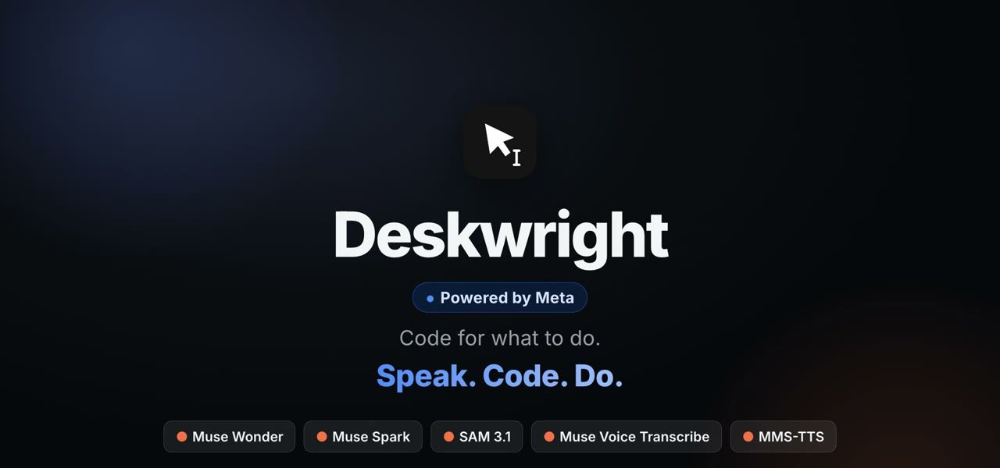
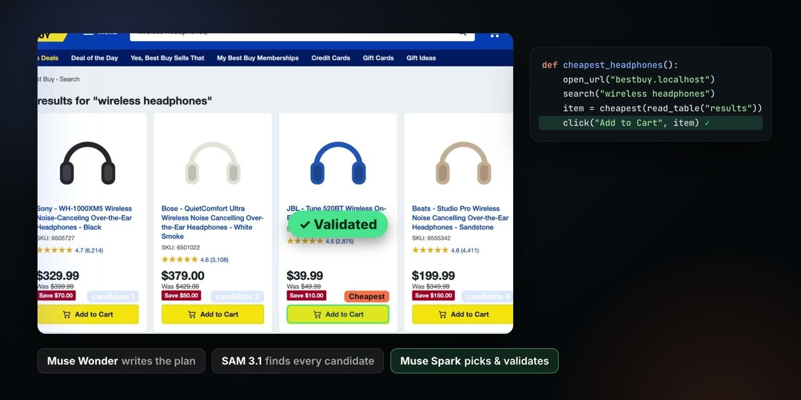
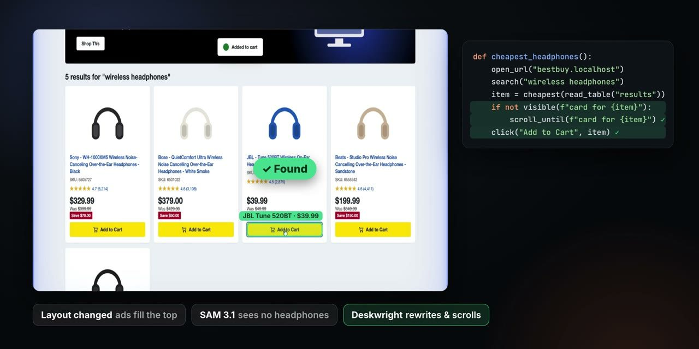
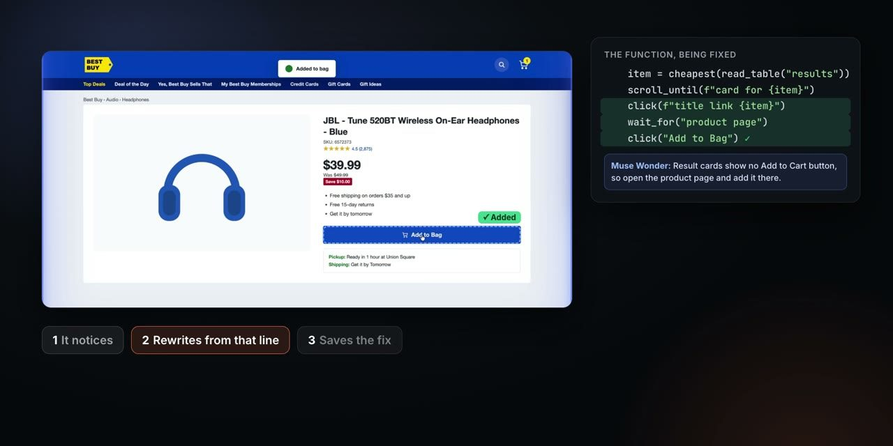
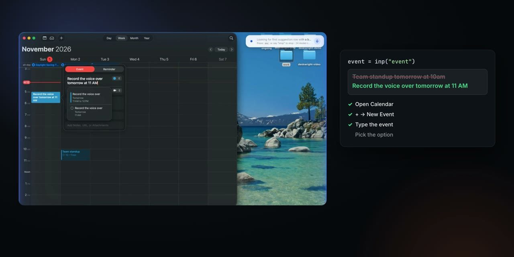
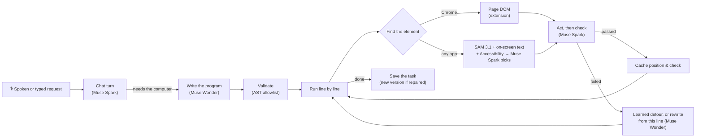

<p align="center">
  
</p>

<p align="center">
  <b>Say what you want. Deskwright writes a program for it, runs it on your Mac, and fixes its own code when the screen changes.</b>
</p>

<p align="center">
  <a href="https://kewlkiid.github.io/deskwright/demo.mp4"></a><br>
  <a href="https://kewlkiid.github.io/deskwright/demo.mp4"><b>▶ Click for the full 3-minute demo with sound</b></a>
</p>

---

## What is Deskwright?

Deskwright is a voice-first desktop agent for macOS, built on Meta's models. You tell it a task out loud ("Agent, post
'I'm really excited to join this' in the intros channel of the Meta hackathon Discord") and it does the task in your
real apps, by looking at the screen and clicking, typing and reading the way a person would.

What makes it different is that **every task becomes code**. Deskwright doesn't improvise clicks one at a time: Muse
Wonder writes a short Python program for the request, and that program runs line by line. Because the task is a
program:

- **It can be checked.** Every step says what it expects to see next, and Muse Spark verifies the screen after each
  one.
- **It can be repaired.** When a step fails because a site was redesigned or an app moved a button, Muse Wonder
  rewrites the program from the failing line, the run keeps going, and the fixed version is saved.
- **It gets faster.** Element positions and passed checks are cached, so a rerun of the same task needs far fewer
  model calls.
- **It can be reused.** Saved tasks take inputs, so "post X in channel Y" becomes a function you can call again
  with new words, from the app, the terminal or Python.

No API, no integrations and no MCP server for the target app: if a person can do it on the screen, Deskwright can
write the program for it.

## Why it matters

- **Computer use for everyone.** Deskwright is hands-free: it starts on a spoken wake word, talks back, and asks
  before anything consequential. People who can't use a keyboard or mouse can use any app on their Mac.
- **Automation without APIs.** Most software people use every day has no API. Deskwright turns any app into
  something you can script, and keeps that script working when the app changes.
- **Show it once.** Do a task while it watches and it compiles your demonstration into a reusable program, with the
  values you typed turned into inputs.

## The demo, step by step

The store and other sites in the demo are local mockups built for demo purposes only. Deskwright is not affiliated
with, or endorsed by, any company or app shown.

| | |
|---|---|
|  | **Writes, finds, picks, validates.** Muse Wonder writes the function; SAM 3.1 finds every candidate element on screen; Muse Spark picks the right one and validates the result. |
|  | **Self-healing on a redesigned site.** The store moved its results below a row of sponsored ads. SAM sees no headphones where they used to be, Deskwright scrolls down, finds the real result and finishes the job. |
|  | **How a fix works.** A check fails (*"Expected: yellow Add to Cart button. Muse Spark sees: only the title, SKU, rating and price"*), Muse Wonder rewrites the function from that line ("open the product page and add it there"), and the repaired version is saved as v2 of the task. |
|  | **Teach once, reuse with new words.** A Calendar task shown once by demonstration runs again with a new input: "Team standup tomorrow at 10am" becomes "Record the voice over tomorrow at 11 AM". |

## Meta models

Every model call in Deskwright goes to a Meta model. The planner, vision, grounding and speech models run through
the [Meta Model API](https://dev.meta.ai/products/meta-model-api); the voice runs locally from Meta's open weights.

| Model | Role in Deskwright |
|---|---|
| **Muse Wonder** (`muse-wonder-1.0`) | The planner. Writes the program for each request, rewrites it from the failing line when a step breaks, and generalizes teach-mode demonstrations into reusable tasks with inputs. |
| **Muse Spark** (`muse-spark-1.3`) | The eyes. Answers the program's questions about the screen (`ask`, `check`, `expect`, `read_text`), picks the right element among SAM's candidates, verifies every step, runs the chat, and drives the grid grounding fallback. |
| **SAM 3.1** (`sam-3.1`) | Grounding. Given a screenshot and a phrase like "Add to Cart button", returns boxes for every matching element (via `/v1/responses`). |
| **Muse Voice Transcribe** (`muse-voice-transcribe-1.0`) | Speech to text for spoken requests and answers (via `/v1/asr/transcribe`). |
| **MMS-TTS** (`facebook/mms-tts-*`, open weights) | Talking back, on-device, in English, Spanish, French, German and Portuguese. |

## How it works



1. **Chat first.** Every message goes to a quick Muse Spark turn. It answers normally and only calls the planner
   when you want something done on the computer.
2. **A program, not a plan.** Muse Wonder writes Python against a small SDK (`open_app`, `click`, `type_into`,
   `ask`, `expect`, `wait_for`, `scroll_until`, `read_table`, ...). Targets are described in words ("search field
   in the header"), not coordinates, so the program survives window moves and theme changes.
3. **Safe to run.** Before anything runs, the program is parsed and checked: only SDK calls and safe built-ins are
   allowed. It then runs one statement at a time in a restricted namespace, and each line reports when it starts
   and passes.
4. **Grounding.** In Chrome, the [extension](extension/) gives Deskwright the page's DOM, so it clicks real
   elements. Everywhere else, SAM 3.1 boxes the candidates, on-device OCR and macOS Accessibility add exact text
   and controls, and Muse Spark picks the one the line means. If SAM finds nothing, a labelled-grid pass with Muse
   Spark is the backup.
5. **Every step is verified.** Actions carry an `expect=` that Muse Spark checks against the new screen. A click
   that "worked" on the wrong thing is caught here, not three steps later.
6. **Self-healing.** When a line fails, Deskwright first tries a learned detour (a known way back to that step, no
   model call). Otherwise Muse Wonder gets the failure, the screenshot and the program so far, and writes a
   continuation from that line. The run resumes in the same namespace, without starting over. The repaired program
   is saved as the task's next version, so the next run doesn't need the fix.
7. **The cache.** Element positions are remembered with a fingerprint of the pixels, and only reused when a fresh
   crop of the screen still matches. Passed checks are remembered with a screen signature. A repeat run skips most
   model calls; in our runs the app reports second runs of the same task at **1.2–2.4× faster** and up to **48%
   cheaper** than the first.
8. **Teach mode.** Press **Teach**, do the task once, press **Finish**. Deskwright records the screen, your clicks
   and keystrokes (and the DOM steps in Chrome), describes each step, and Muse Wonder compiles it into a program
   whose typed values become inputs.

### Safety

- **Approvals.** Sending, posting, buying, deleting and similar actions always ask first, whatever the program
  says, and a repaired step still owes the approval of the step it replaced.
- **Apps it must never touch.** `NEVER_OPEN` (default: Slack) lists apps Deskwright refuses to open, switch to or
  launch, even if a request or a program names them.
- **Restricted programs.** Generated code can only call the SDK; no imports, files or shell.
- **Local only.** The engine's WebSocket and the Chrome bridge listen on 127.0.0.1 behind random tokens; the API
  key never leaves the engine. The wake word is recognized on-device, so nothing leaves the Mac until you say
  "Agent".
- **One run at a time.** A cross-process lock keeps two runs from fighting over the mouse and keyboard.

## Example: a program Deskwright wrote

This is the saved "best buy headphones" task after it repaired itself on a redesigned store (abridged). Every
target is plain English; `progress.reached` lets a resumed run skip stages it already finished.

```python
INPUTS = {"search_term": "str: product category to search for, e.g. wireless headphones"}
OUTPUTS = {"product_name": "str: name of the cheapest product added to the cart", "price": "...", "cart_total": "..."}

query = inp("search_term")
if not progress.reached("Find cheapest headphones"):
    open_url("http://bestbuy.localhost")
    click("magnifying glass search icon in the top-right of the blue Best Buy header", expect="search field appears in the header")
    type_into("search field in the header", query, expect="search field shows the search term")
    press("enter")
    wait_for("search results are shown", timeout=20)
    product_name = ask("What is the name of the first product in the search results sorted by price low to high?")
    checkpoint("Find cheapest headphones")
scroll_until(f"product card for {product_name}")
click(f"blue product title link '{product_name}' in the search results", expect="product detail page is shown")
click("blue Add to Bag button on the right side of the product detail page", expect="shopping cart icon in the top-right header shows 1 item")
output(product_name=product_name, cart_total=ask("What is the exact Total amount in the Order Summary?"))
```

## Use it from code

Saved tasks are functions. Call them from Python:

```python
import deskwright

deskwright.tasks()                                   # saved tasks with their inputs and outputs
out = deskwright.run("post in discord intros", {"message": "hi"}, approve=True)
out = deskwright.do("what's the temperature in New York? use the weather app")
print(out)                                           # the task's OUTPUTS, e.g. {"posted": True}
```

Or export one and run it as a plain Python file. A file that starts with `from deskwright import *` runs inside
Deskwright, with inputs passed as `key=value`; the app doesn't need to be open:

```bash
python3 city_temps.py cities="Paris, Sydney, Toronto"
```

Any other language can use the CLI, which prints exactly one JSON line:

```bash
engine/.venv/bin/python -m engine.cli tasks --json
engine/.venv/bin/python -m engine.cli run --saved "best buy headphones" --input search_term="wireless headphones" --json --no-ask
# {"status": "ok", "outputs": {...}, "error": null, "run_id": 67}
```

## Getting started

**Requirements:** macOS, Python 3 (developed on 3.14), Node 18+, a [Meta Model API](https://dev.meta.ai/docs/quickstart) key.

```bash
./setup.sh                      # Python venv for the engine + the Electron app's packages
# put your key in .env:  MODEL_API_KEY=...
cd app && npm run dev           # real models
cd app && npm run dev:fake      # offline fakes: the mouse moves but never clicks
```

On first run, macOS asks for **Screen Recording**, **Accessibility** and **Microphone** access; Deskwright needs all
three to see the screen, act on it and hear you.

**Optional: the Chrome extension** for DOM-level actions in Chrome. Open `chrome://extensions`, turn on Developer
mode, click **Load unpacked** and pick [`extension/`](extension/). Details are in its
[README](extension/README.md).

**Configuration** lives in `.env` (see [`.env.example`](.env.example)): per-role model overrides
(`PLANNER_MODEL`, `VISION_MODEL`, `GROUNDING_MODEL`, `VOICE_MODEL`, `TTS_MODEL`), `NEVER_OPEN`, the wake word, and
the app's language.

**Tests:**

```bash
engine/.venv/bin/python -m pytest engine/tests      # 163 tests, offline (fake models and screen)
```

## Repository layout

| Path | What's there |
|---|---|
| [`app/`](app/) | The Electron + React side panel: chat, voice, approvals, the live program view with per-line status, saved tasks, teach mode, run metrics. |
| [`engine/`](engine/) | The Python engine, spawned by the app (or used directly through the CLI). |
| [`engine/models/`](engine/models/) | Meta model clients: planner (Muse Wonder), vision and chat (Muse Spark), grounding (SAM 3.1, grid fallback), voice (Muse Voice Transcribe), wake word. |
| [`engine/runner/`](engine/runner/) | Script validation, the line-by-line executor, self-healing and learned detours, the screen lock. |
| [`engine/sdk/`](engine/sdk/) | The SDK generated programs call (`click`, `type_into`, `ask`, `expect`, `scroll_until`, ...), plus approvals. |
| [`engine/cache/`](engine/cache/) | The position cache and the check cache. |
| [`engine/teach/`](engine/teach/) | Teach mode: the recorder and the demonstration-to-program compiler. |
| [`engine/browser/`](engine/browser/) | The bridge to the Chrome extension: DOM targets, network capture, the browser cache. |
| [`engine/screen/`](engine/screen/) | Screenshots, input, on-device OCR, macOS Accessibility, window handling. |
| [`engine/speaker.py`](engine/speaker.py) | Talking back with MMS-TTS, in five languages. |
| [`extension/`](extension/) | The Chrome extension (Manifest V3). |
| [`deskwright.py`](deskwright.py) | The Python interface: `do`, `run`, `run_script`, `tasks`, and `from deskwright import *` scripts. |

## Built during the hackathon

Deskwright was built for the **Meta Global AI Developer Hackathon** (building period Oct 27 – Nov 4, 2026). Work
started on Oct 29; this repository was created on Oct 31, so its first commit holds those first two days of work,
and everything since is in the commit history. Built during the event:

- The self-programming agent loop: chat → Muse Wonder program → validated, line-by-line execution
- Grounding that combines SAM 3.1, on-device OCR and macOS Accessibility, with Muse Spark choosing and verifying
- Self-healing from the failing line, learned detours, and versioned saved tasks
- The position cache and check cache
- Teach mode, including Chrome DOM recording
- Voice: wake word, Muse Voice Transcribe, MMS-TTS talk-back, five languages
- The Electron side panel, the Chrome extension, the CLI and the Python interface
